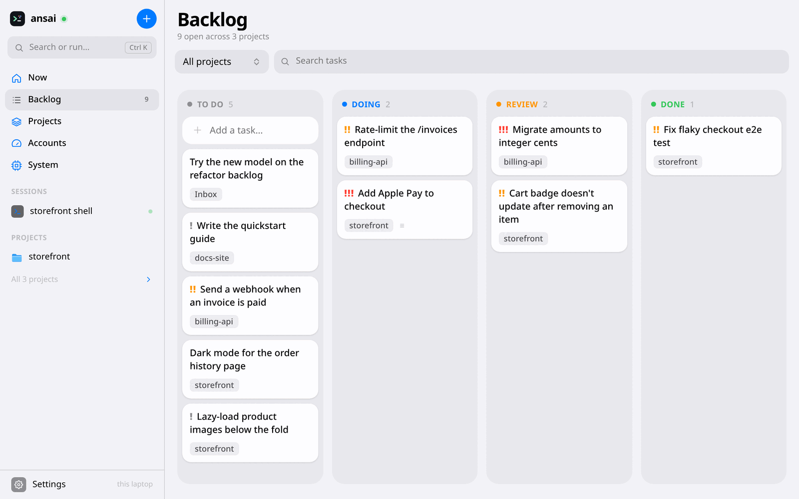
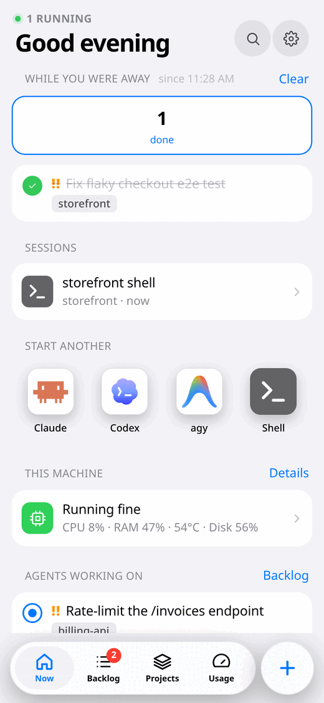
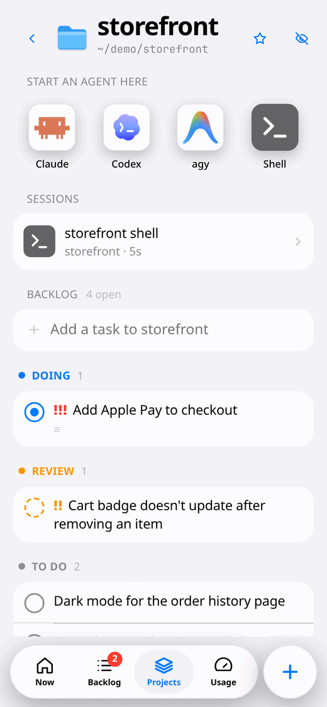
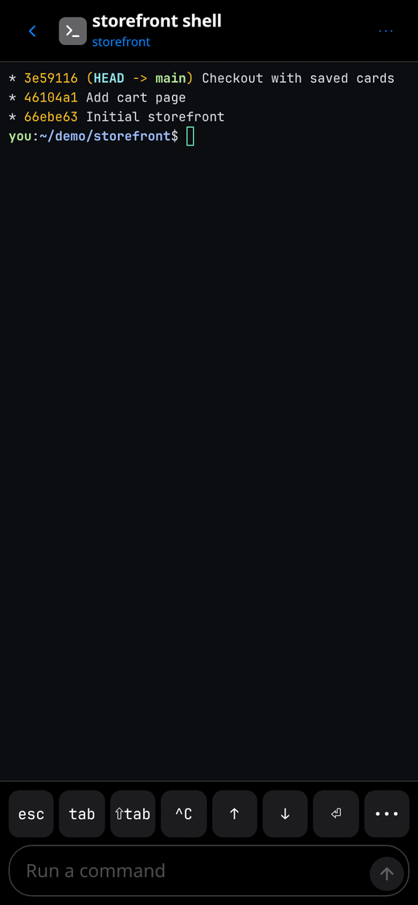

# ansai

**A control room for your coding agents.** Run Claude Code, Codex and agy on your laptop, then
drive them from your phone: start them, answer them, hand them tasks, and let them work the
backlog while you're away.



<p align="center">
  
  
  
</p>

## What you get

- **Every agent in one place:** real terminals and a chat view for each agent, with a key bar and compose box made for phones.
- **A backlog that agents work through:** write a task, hand it to an agent, and review the diff when it's done. Each task gets its own git worktree.
- **Agents that keep working:** autopilot, schedules, overnight shifts, and agents that message each other so they don't edit the same files.
- **Push notifications** when an agent needs you, with Allow / Deny right in the notification.
- **Private:** it listens only on your laptop. Your phone reaches it through your own Tailscale network.

The full list is in [docs/features.md](docs/features.md).

## Try it

You need Linux, [Bun](https://bun.sh), `tmux` and `git`, plus the agents you want to use (`claude`, `codex`, `agy`).

```sh
git clone https://github.com/hangsiahong/ansai && cd ansai
bun install
bun run dev                      # open http://localhost:7777
```

To keep it running, install it as a service with `./scripts/install-service.sh`.

**On your phone:** install [Tailscale](https://tailscale.com) on both the laptop and the phone,
run `tailscale serve --bg 7777` on the laptop, and open the URL it prints on your phone.
Then use **Add to Home Screen**.

## Contributing

You don't need to write the code yourself:

1. Fork the repo and open it in Claude Code with **Opus** or **Fable**.
2. Tell it what you want changed. Ask it to make `bun run typecheck && bun test` pass.
3. Open a pull request that says what changed and why.

Our reviewer agent reads every pull request. If the change is good, it gets approved and merged.
Bug reports and ideas are welcome as issues too.
